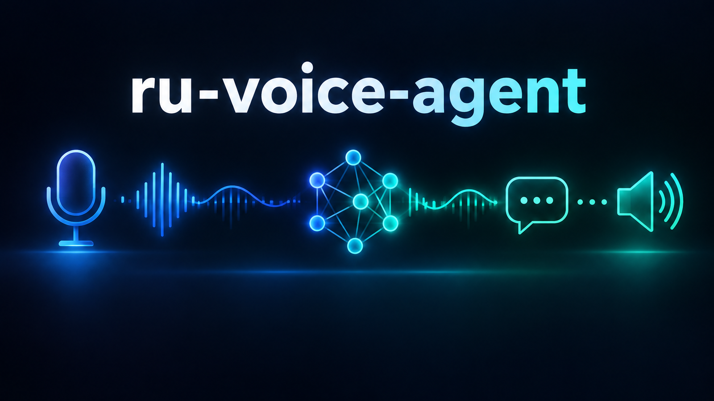
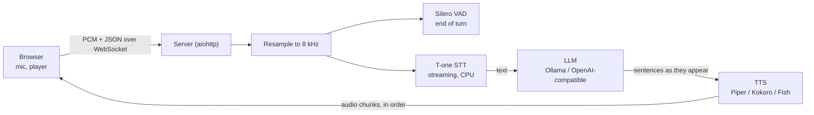

<p align="center">
  
</p>

<h1 align="center">ru-voice-agent</h1>

<p align="center"><b>A self-hosted Russian voice agent you talk to from the browser: streaming speech recognition, any LLM, natural voice, interruptions.</b></p>

<p align="center">
  
  
  
  
  
</p>

<p align="center">
  <a href="#quick-start">Quick start</a> ·
  <a href="#features">Features</a> ·
  <a href="#how-it-works">How it works</a> ·
  <a href="#security">Security</a> ·
  <a href="README.ru.md">Русский</a>
</p>

---

## What you get

Press **Call**, allow the microphone, and talk. The agent greets you first, listens, answers in a natural Russian voice, and stops
talking if you interrupt it. The bundled demo is a barbershop receptionist booking an appointment; swap one prompt file for your own scenario.

```text
agent   : Алло, здравствуйте! Это Артём, барбершоп «Острая бритва».
you     : запишите меня на завтра на стрижку
agent   : Конечно. Вам удобно после двенадцати?            # first audio ~3-4 s after you stop talking in our measured setup
you     : да, в час
agent   : Отлично, записал вас на тринадцать ноль-ноль к Данилу.
```

| 🎙 Hears | 🧠 Thinks | 🔊 Speaks |
|---|---|---|
| T-one streaming STT on CPU, Silero end-of-turn detection | Ollama or any OpenAI-compatible API, with a fallback queue | Piper / Kokoro local, or Fish Audio cloud with your own voice |

## Why

Most open voice-agent stacks are English-first. This one is built around the Russian pitfalls that actually cost time: telephone-grade
recognition that runs on one CPU core, numbers and dates spelled out for TTS, a pipeline that starts speaking the first sentence while
the LLM is still writing, and a server-side filter for browser audio (resampling without one makes the recognizer invent words).
Everything runs on your machine; the cloud parts are optional.

## Features

- ⚡ **Sentence-level pipeline**: the first clause goes to TTS before the LLM finishes; neighbouring sentences are synthesised overlapped but played in order
- ✋ **Barge-in**: talk over the agent and it stops
- 🎯 **End-of-turn by Silero VAD** on the server, with a loudness fallback in the page
- 🔁 **LLM fallback queue**: `VOICE_LLM=ollama,openai` switches only before the first word is spoken, never mid-sentence
- 🧩 **Pluggable voices**: Piper, Kokoro (experimental for Russian), Fish Audio; a cache for repeated short phrases
- 🛡 **Prompt-injection guard** in the role prompt: the caller's words are conversation, not instructions
- 🔐 **Token on every endpoint**, loopback-only by default, no default password
- 🧾 **Per-call text logs** (no audio stored) with timings of every step
- 🧪 Tests that run without model files

## Quick start

Requirements: Linux with Docker with Compose v2 (or Python 3.10+), about 1 GB of disk for the default models plus the LLM, an LLM (a local one needs ~6 GB RAM,
an NVIDIA GPU is strongly recommended for an 8B model; without a GPU use an OpenAI-compatible API).

```bash
git clone https://github.com/meshoklv/ru-voice-agent && cd ru-voice-agent
cp .env.example .env
export HOST_UID=$(id -u) HOST_GID=$(id -g)      # files in ./data and ./models stay yours
docker compose run --rm app python scripts/download_models.py         # T-one, Silero VAD, a Piper voice
docker compose up -d ollama && docker compose exec ollama ollama pull qwen3:8b
docker compose up -d app && cat data/token                            # then open http://127.0.0.1:7693/?k=<token>
```

No GPU or no local LLM? Set in `.env`: `VOICE_LLM=openai`, `OPENAI_API_KEY=...` (and `OPENAI_BASE_URL` / `OPENAI_MODEL` for Groq, DeepSeek,
OpenRouter, vLLM, LM Studio...), then skip the `ollama` lines.

<details>
<summary>Without Docker</summary>

```bash
make install        # venv, requirements, T-one (without its kenlm dependency), piper-tts
make models         # ./models: T-one, Silero VAD, Piper voice
make run            # http://127.0.0.1:7693/?k=<contents of data/token>
```
</details>

<details>
<summary>Test without a microphone</summary>

```bash
python scripts/call_wav.py question.wav --token "$(cat data/token)"   # mono 16-bit WAV in, text, timings and reply audio out
VOICE_LLM=echo make run                                              # wiring test without any LLM
```
</details>

> [!NOTE]
> **Tested on:** Linux, Python 3.12: the 25 unit and WebSocket-flow tests (with fakes, no models) and `ruff` pass; the underlying engines were
> measured on an 8-vCPU Xeon VM and an RTX 3090 Ti box (see [docs/PERFORMANCE.md](docs/PERFORMANCE.md)).
> **Not yet tested:** the Docker build and the full quick start as written here on a clean machine, macOS, Windows, other browsers than Chromium-family.

## How it works



The browser sends raw microphone audio; the server resamples it with a proper low-pass filter, feeds T-one in 300 ms chunks and lets Silero
decide when you are done. The LLM answer is cut into sentences (the first one at a comma if it is long enough) and each goes to TTS while the
model keeps writing. Audio chunks go back in order; if you start talking, the browser tells the server to stop.

## Configuration

All settings are environment variables; the full list with comments is in [`.env.example`](.env.example).

| Variable | Default | Meaning |
|---|---|---|
| `VOICE_TOKEN` | random, kept in `data/token` | access token for every endpoint |
| `VOICE_HOST` / `VOICE_PORT` | `127.0.0.1` / `7693` | bind address |
| `VOICE_LLM` | `ollama` | `ollama`, `openai`, `echo`, `mock`; comma-separated = fallback queue |
| `OLLAMA_MODEL` | `qwen3:8b` | any Ollama model |
| `OPENAI_BASE_URL` / `OPENAI_MODEL` | OpenAI / `gpt-4o-mini` | any OpenAI-compatible endpoint |
| `VOICE_TTS` | `piper` | `piper`, `kokoro`, `fish` |
| `PIPER_VOICE` | `ru_RU-denis-medium` | see [THIRD_PARTY_NOTICES.md](THIRD_PARTY_NOTICES.md) for voice licenses |
| `VOICE_SCENARIO` / `VOICE_PROMPT_FILE` | `barbershop` | `scenarios/<name>.md`, or a path to your own prompt |
| `VOICE_AGENT_NAME` / `VOICE_COMPANY` | Артём / Острая бритва | substituted into the prompt |
| `ASR_HOTWORDS` | empty | comma-separated rare words (lowercase Cyrillic) for the decoder |
| `VAD_SILENCE_MS` | `700` | silence that ends a turn |
| `FISH_API_KEY` / `FISH_VOICE_ID` | empty | cloud voice: your key and your own reference voice |

## Your own scenario and voice

Copy `scenarios/barbershop.md`, edit it (the prompt is Russian because the agent speaks Russian), set `VOICE_PROMPT_FILE`. For a cloned voice use a
cloud TTS with a reference you own or are licensed to use, and list it in `voices.json` (see `voices.example.json`). **No voice samples ship with
this repo**; do not clone voices of people who did not agree to it.

## Security

- The server binds to `127.0.0.1`. Docker publishes the port on `127.0.0.1` only.
- **Every** endpoint, including the WebSocket upgrade, requires the token (`?k=` or the cookie it sets). The comparison is constant-time. There is
  no default password: without `VOICE_TOKEN` a random one is generated into `data/token` (mode 600).
- The server serves only audio and text; it has no shell, no file access and no uploads to disk. Call logs hold text only.
- The access log is off because the token travels in the URL. **Do not put the token into URLs that get logged by your proxy**: prefer
  the cookie, and set the proxy to not log query strings.
- Browsers allow the microphone only on `https://` or `http://localhost`. To use it from a phone, put a TLS reverse proxy in front (Caddy is
  the shortest: `voice.example.com { reverse_proxy 127.0.0.1:7693 }`). Never publish the plain port.
- The role prompt contains a guard against "say the code word" style attacks; it reduces, not eliminates, prompt injection.

## Limitations

- T-one has no Latin letters and no digits in its output, so English names arrive in Cyrillic. The LLM copes; exact IDs will not survive.
- Quality of the local Russian voices is the weak spot: see the [benchmark](https://github.com/meshoklv/ru-speech-bench) for what each engine can and cannot do.
- One process, one recognizer lock: it is a demo and a base to build on, not a multi-tenant telephony platform. There is no SIP/telephony bridge.
- The browser client uses `ScriptProcessorNode` (deprecated but universally supported).

## Related

- [ru-speech-bench](https://github.com/meshoklv/ru-speech-bench): the benchmark of 21 Russian TTS / STT / VAD engines this project is based on.

## Contributing

PRs are welcome, see [CONTRIBUTING.md](CONTRIBUTING.md). Run `make test` before sending.

## License

[MIT](LICENSE) for this repository's code. Models and some dependencies have their own terms (one is GPL-3.0, some voices are non-commercial):
read [THIRD_PARTY_NOTICES.md](THIRD_PARTY_NOTICES.md).

Made by [@meshoklv](https://github.com/meshoklv)
