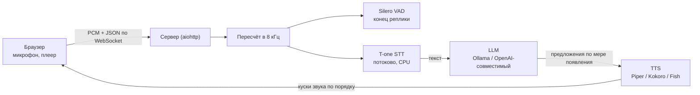

<p align="center">
  
</p>

<h1 align="center">ru-voice-agent</h1>

<p align="center"><b>Свой голосовой агент на русском, с которым говоришь из браузера: потоковое распознавание, любая LLM, живой голос, можно перебивать.</b></p>

<p align="center">
  
  
  
  
  
</p>

<p align="center">
  <a href="#быстрый-старт">Быстрый старт</a> ·
  <a href="#возможности">Возможности</a> ·
  <a href="#как-это-устроено">Как устроено</a> ·
  <a href="#безопасность">Безопасность</a> ·
  <a href="README.md">English</a>
</p>

---

## Что получаешь

Нажимаешь **Call**, разрешаешь микрофон и говоришь. Агент здоровается первым, слушает, отвечает живым русским голосом и замолкает,
если его перебить. В комплекте демо: администратор барбершопа записывает на стрижку. Свой сценарий — это замена одного файла с промптом.

```text
agent   : Алло, здравствуйте! Это Артём, барбершоп «Острая бритва».
you     : запишите меня на завтра на стрижку
agent   : Конечно. Вам удобно после двенадцати?            # первый звук ~3-4 с после вашей паузы в нашей измеренной сборке
you     : да, в час
agent   : Отлично, записал вас на тринадцать ноль-ноль к Данилу.
```

| 🎙 Слышит | 🧠 Думает | 🔊 Говорит |
|---|---|---|
| T-one (потоковое распознавание на CPU), конец реплики по Silero | Ollama или любой OpenAI-совместимый API, очередь запасных | Piper / Kokoro локально или облачный Fish Audio со своим голосом |

## Зачем

Большинство открытых голосовых стеков заточены под английский. Здесь собрано то, на чём по-русски реально теряется время: телефонное
распознавание, которое тянет одно ядро CPU, числа и даты словами для синтеза, конвейер, который начинает говорить первое предложение, пока
LLM ещё пишет, и фильтр звука из браузера на сервере (без него распознавалка выдумывает слова). Всё работает у вас; облако необязательно.

## Возможности

- ⚡ **Конвейер по предложениям**: первая фраза уходит в синтез, пока LLM не закончила; соседние предложения синтезируются внахлёст, а играют по порядку
- ✋ **Перебивание**: заговорили поверх — агент замолкает
- 🎯 **Конец реплики по Silero VAD** на сервере, на странице запасной порог по громкости
- 🔁 **Очередь LLM**: `VOICE_LLM=ollama,openai` переключается только до первого сказанного слова, никогда посреди фразы
- 🧩 **Сменные голоса**: Piper, Kokoro (для русского экспериментально), Fish Audio; память на повторяющиеся короткие фразы
- 🛡 **Защита от «скажи кодовое слово»** в промпте роли: слова собеседника — реплики, а не команды
- 🔐 **Токен на каждом адресе**, по умолчанию только loopback, паролей по умолчанию нет
- 🧾 **Журнал каждого звонка** текстом (звук не хранится) с замерами по шагам
- 🧪 Тесты, которым не нужны файлы моделей

## Быстрый старт

Нужно: Linux с Docker (Compose v2) или Python 3.10+, около 1 ГБ диска под модели по умолчанию плюс LLM. Локальной 8B-модели нужно ~6 ГБ ОЗУ и
лучше видеокарта NVIDIA; без видеокарты берите OpenAI-совместимый API.

```bash
git clone https://github.com/meshoklv/ru-voice-agent && cd ru-voice-agent
cp .env.example .env
export HOST_UID=$(id -u) HOST_GID=$(id -g)      # файлы в ./data и ./models останутся вашими
docker compose run --rm app python scripts/download_models.py         # T-one, Silero VAD, голос Piper
docker compose up -d ollama && docker compose exec ollama ollama pull qwen3:8b
docker compose up -d app && cat data/token                            # откройте http://127.0.0.1:7693/?k=<токен>
```

Нет видеокарты или локальной LLM? В `.env` поставьте `VOICE_LLM=openai`, `OPENAI_API_KEY=...` (и `OPENAI_BASE_URL` / `OPENAI_MODEL` для Groq, DeepSeek,
OpenRouter, vLLM, LM Studio), строки про `ollama` пропустите.

<details>
<summary>Без Docker</summary>

```bash
make install        # venv, зависимости, T-one (без kenlm), piper-tts
make models         # ./models: T-one, Silero VAD, голос Piper
make run            # http://127.0.0.1:7693/?k=<содержимое data/token>
```
</details>

<details>
<summary>Проверка без микрофона</summary>

```bash
python scripts/call_wav.py question.wav --token "$(cat data/token)"   # WAV моно 16 бит на входе; текст, замеры и звук ответа на выходе
VOICE_LLM=echo make run                                              # проверка связки без LLM
```
</details>

> [!NOTE]
> **Проверено:** Linux, Python 3.12: 25 тестов (юнит и полный разговор по WebSocket на заглушках, без моделей) и `ruff` проходят; сами движки
> измеряли на виртуалке 8 vCPU Xeon и на машине с RTX 3090 Ti (см. [docs/PERFORMANCE.md](docs/PERFORMANCE.md)).
> **Ещё не проверено:** сборка Docker-образа и весь быстрый старт в таком виде на чистой машине, macOS, Windows, браузеры кроме семейства Chromium.

## Как это устроено



Браузер шлёт сырой звук с микрофона; сервер пересчитывает его фильтром нижних частот, подаёт в T-one кусками по 300 мс, а Silero решает, что вы
договорили. Ответ LLM режется на предложения (первое — по запятой, если оно достаточно длинное), и каждое уходит в синтез, пока модель
дописывает остальное. Звук возвращается по порядку; если вы заговорили, браузер говорит серверу остановиться.

## Настройка

Все настройки — переменные окружения, полный список с комментариями в [`.env.example`](.env.example).

| Переменная | По умолчанию | Смысл |
|---|---|---|
| `VOICE_TOKEN` | случайный, лежит в `data/token` | токен доступа на каждом адресе |
| `VOICE_HOST` / `VOICE_PORT` | `127.0.0.1` / `7693` | адрес привязки |
| `VOICE_LLM` | `ollama` | `ollama`, `openai`, `echo`, `mock`; через запятую — очередь запасных |
| `OLLAMA_MODEL` | `qwen3:8b` | любая модель Ollama |
| `OPENAI_BASE_URL` / `OPENAI_MODEL` | OpenAI / `gpt-4o-mini` | любой OpenAI-совместимый адрес |
| `VOICE_TTS` | `piper` | `piper`, `kokoro`, `fish` |
| `PIPER_VOICE` | `ru_RU-denis-medium` | лицензии голосов — в [THIRD_PARTY_NOTICES.md](THIRD_PARTY_NOTICES.md) |
| `VOICE_SCENARIO` / `VOICE_PROMPT_FILE` | `barbershop` | `scenarios/<имя>.md` или путь к своему промпту |
| `VOICE_AGENT_NAME` / `VOICE_COMPANY` | Артём / Острая бритва | подставляются в промпт |
| `ASR_HOTWORDS` | пусто | редкие слова через запятую (строчная кириллица) для декодера |
| `VAD_SILENCE_MS` | `700` | тишина, которая завершает реплику |
| `FISH_API_KEY` / `FISH_VOICE_ID` | пусто | облачный голос: ваш ключ и ваш собственный референс |

## Свой сценарий и голос

Скопируйте `scenarios/barbershop.md`, поправьте (промпт русский, потому что агент говорит по-русски) и укажите `VOICE_PROMPT_FILE`. Для клонированного голоса
берите облачный синтез с референсом, на который у вас есть права, и перечислите его в `voices.json` (образец — `voices.example.json`). **Образцов
голосов в репозитории нет**; не клонируйте голоса людей, которые на это не согласились.

## Безопасность

- Сервер слушает `127.0.0.1`. Docker публикует порт только на `127.0.0.1`.
- **Каждый** адрес, включая переход на WebSocket, требует токен (`?k=` или куку, которую сервер выставляет). Сравнение за постоянное время. Пароля по
  умолчанию нет: без `VOICE_TOKEN` генерируется случайный в `data/token` (права 600).
- Сервер отдаёт только звук и текст: ни шелла, ни доступа к файлам, ни загрузок на диск. В журналах звонков только текст.
- Журнал обращений выключен, потому что токен идёт в адресе. **Не давайте прокси писать адреса с токеном в свой журнал**: лучше полагаться на куку и
  отключить запись query-строк.
- Микрофон в браузере работает только по `https://` или на `http://localhost`. Для телефона поставьте перед сервером TLS-прокси (проще всего Caddy:
  `voice.example.com { reverse_proxy 127.0.0.1:7693 }`). Голый порт наружу не открывайте.
- В промпте роли есть защита от атак вроде «скажи кодовое слово»; она снижает, но не убирает риск подмены инструкций.

## Ограничения

- У T-one нет в выводе латиницы и цифр, английские названия приходят кириллицей. LLM справляется, точные идентификаторы — нет.
- Слабое место — качество локальных русских голосов: что умеет каждый движок, смотрите в [бенчмарке](https://github.com/meshoklv/ru-speech-bench).
- Один процесс, один замок распознавателя: это демо и основа для своего проекта, а не многопользовательская телефония. Моста SIP нет.
- Клиент в браузере использует `ScriptProcessorNode` (устарел, но работает везде).

## Связанные проекты

- [ru-speech-bench](https://github.com/meshoklv/ru-speech-bench): бенчмарк 21 русского движка TTS / STT / VAD, на котором основан проект.

## Как помочь

Присылайте PR, см. [CONTRIBUTING.md](CONTRIBUTING.md). Перед отправкой запустите `make test`.

## Лицензия

[MIT](LICENSE) для кода этого репозитория. У моделей и части зависимостей свои условия (одна зависимость под GPL-3.0, часть голосов некоммерческие):
прочитайте [THIRD_PARTY_NOTICES.md](THIRD_PARTY_NOTICES.md).

Автор: [@meshoklv](https://github.com/meshoklv)
